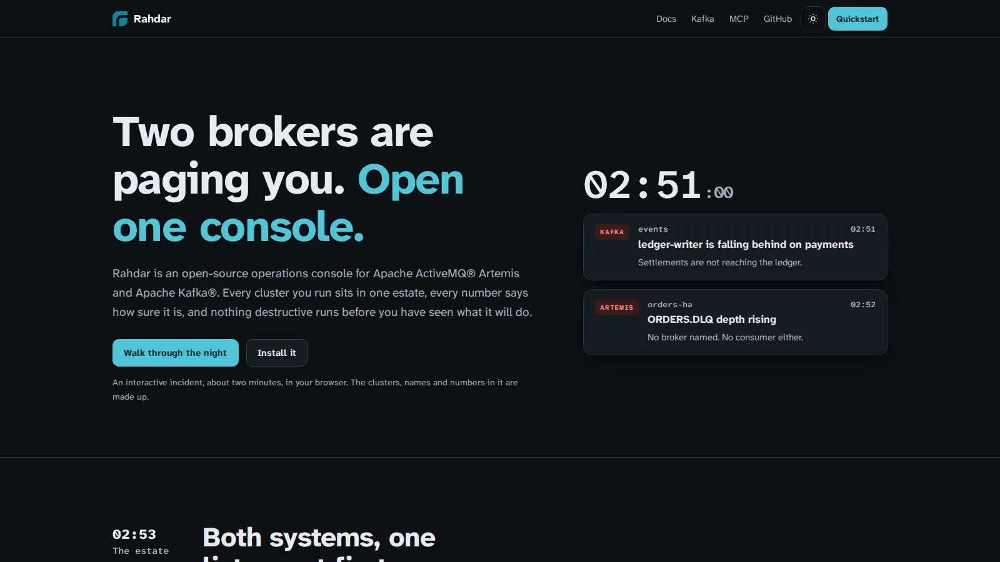
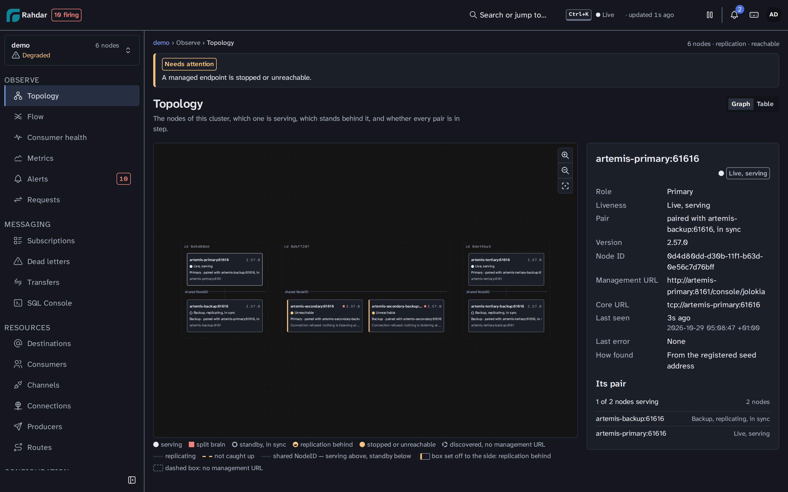
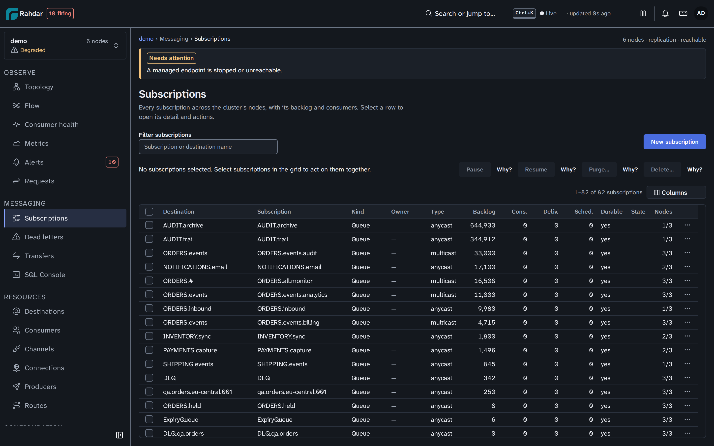

<div align="center">


# Rahdar

<sub><em>Rahdar</em>（波斯语 راهدار，意为“守路人”）= <em>rah</em>（路）+ <em>dar</em>（守护者）：守护消息走过的每一条路，让它畅通而安全。</sub>

**一个开源控制台，管好你的 Apache ActiveMQ® Artemis 与 Apache Kafka® 集群。**

你运行的每一个集群都在同一个资产视图中，延迟如实标为估算值，破坏性操作先预览，审批闸门对人和助手一视同仁。

<a href="https://rahdar.dev/"></a><br>
<sub>一场交互式的值班之夜 · 约 2 分钟 · 直接在浏览器里运行</sub>

[English](README.md) · **简体中文** · [فارسی](README.fa.md)

[](https://github.com/sudoitir/rahdar/actions/workflows/ci.yml)
[](https://github.com/sudoitir/rahdar/releases)
[](https://hub.docker.com/r/sudoit1/rahdar)
[](https://scorecard.dev/viewer/?uri=github.com/sudoitir/rahdar)
[](https://sonarcloud.io/summary/new_code?id=sudoitir_rahdar)
[](https://sonarcloud.io/summary/new_code?id=sudoitir_rahdar)
[](https://sonarcloud.io/summary/new_code?id=sudoitir_rahdar)
[](https://sonarcloud.io/summary/new_code?id=sudoitir_rahdar)
[](https://sonarcloud.io/summary/new_code?id=sudoitir_rahdar)
[](LICENSE)

[文档](https://rahdar.dev/zh/guide/) ·
[快速开始](#快速开始) ·
[Kafka](https://rahdar.dev/guide/kafka) ·
[Flow](https://rahdar.dev/guide/flow) ·
[SQL Console](https://rahdar.dev/zh/guide/sql-console) ·
[MCP](https://rahdar.dev/zh/guide/mcp) ·
[讨论区](https://github.com/sudoitir/rahdar/discussions)

</div>

> [!WARNING]
> **Alpha 阶段。** 项目仍在快速迭代，功能尚不完整。目前发布的镜像都是稳定版之前的 dev 构建
> （`sudoit1/rahdar:dev`，还没有 `:latest`），后续版本可能包含不兼容的变更。


## 快速开始

用已发布的镜像启动 Rahdar 及其 Postgres。你的 Broker 保持原样：在界面里注册即可，这里不会启动任何 Broker。

```bash
base=https://raw.githubusercontent.com/sudoitir/rahdar/main/deploy/compose
mkdir -p rahdar/compose rahdar/postgres && cd rahdar/compose   # the compose file mounts ../postgres
curl -sO "$base/compose.prod.yaml"
for f in postgresql.conf 10-pg-stat-statements.sql; do curl -s "${base%/compose}/postgres/$f" -o "../postgres/$f"; done
curl -s "$base/.env.example" | sed \
  -e "s|^SECRET_KEY=.*|SECRET_KEY=$(openssl rand -base64 32)|" \
  -e "s|^DB_PASSWORD=.*|DB_PASSWORD=$(openssl rand -hex 24)|" > .env
docker compose -f compose.prod.yaml --env-file .env up -d
docker compose -f compose.prod.yaml logs rahdar | grep -A4 'Created administrator'
```

打开 <http://localhost:8080>，用 `admin` 和最后一行打印出的密码登录。这个密码只显示一次，首次登录时你会设置自己的密码，并设置 admin 角色所要求的两步验证。

<details>
<summary>克隆仓库后用 <code>just</code> 启动，或者单独跑一个容器、连接你自己的 Postgres</summary>

```bash
git clone https://github.com/sudoitir/rahdar && cd rahdar
just up          # 两个副本置于 HAProxy 之后，锁定到最新发布版本（just up-single：单副本）
```

```bash
docker run -p 8080:8080 \
  -e RAHDAR_DB_URL=jdbc:postgresql://db:5432/rahdar \
  -e RAHDAR_DB_USER=rahdar \
  -e RAHDAR_DB_PASSWORD=... \
  -e RAHDAR_SECRET_KEY="$(openssl rand -base64 32)" \
  sudoit1/rahdar:dev
```

</details>

所有环境变量、反向代理为支持 SSE 流需要做的设置，以及首次登录信息丢失后如何恢复，都写在[配置指南](https://rahdar.dev/zh/guide/configuration)里。

## 为什么做这个

凌晨 02:51，两条告警同时响起：Kafka 的一个消费者组在 `payments` 上越落越远，Artemis 的一对节点上 `ORDERS.DLQ` 正在堆积。没有 Rahdar 的话，就是每个 Artemis Broker 开一个管理控制台标签页，终端里跑 `kafka-consumer-groups.sh` 和 `kafka-transactions.sh`，中间还得自己心算。

Rahdar 把**你运行的每一个集群放进同一个资产视图**，不论 Broker 是哪种。健康状况按同一标尺判断，所有积压汇总在一张表里、最严重的排最前：Artemis 队列与 Kafka 消费者组并列，各自使用自己的名称。每个数字都会说明它有多确定：Artemis 队列的深度是精确值，Kafka 消费者组的延迟是估算值，并附逐分区明细；Rahdar 读不到的数字会如实说明，而不是显示为 0。任何破坏性操作在你看到它将做什么之前都不会执行；启用审批闸门后，还需要第二个人批准。

<a href="https://rahdar.dev/"></a>

**[▶ 体验这个故事（英文）](https://rahdar.dev/)**：找出延迟背后那个挂起的事务并中止它，用一次按住确认的审批重置一个消费者组，再清空 Artemis 的死信队列，全部在同一个资产视图里完成。

## 功能一览

| 集群拓扑 | 跨节点队列 |
|---|---|
| [](docs/img/topology.png) | [](docs/img/queues.png) |
| **客户端与消息流向** | **SQL Console** |
| [](docs/img/flow.gif) | [](docs/img/sql-console.gif) |
| **插件** | **设置** |
| [](docs/img/plugin-install.gif) | [](docs/img/settings.png) |

Rahdar 通过 [OpenBroker](https://github.com/sudoitir/openbroker) 与 Broker 通信，这是一个开源的 Broker SDK，每个系统一个驱动。各系统共有的界面（资产视图、订阅与目的地、消息浏览、清空、审计记录、API 与 MCP）在每个系统上都能用，并使用该系统自己的术语；某个系统做不到的操作依然可见，置灰并说明原因。

| 系统 | 支持版本 | 指南 |
| --- | --- | --- |
| Apache ActiveMQ® Artemis | 2.33.0 及以上 | [指南](https://rahdar.dev/zh/guide/) |
| Apache Kafka® | 3.0 及以上，KRaft 与 ZooKeeper 模式 | [Kafka](https://rahdar.dev/guide/kafka) |
| RabbitMQ | 即将推出；目前尚不支持 | |

详情，以及超出这些范围时会发生什么：[支持的 Broker 版本](https://rahdar.dev/guide/supported-versions)。

### Apache Kafka

- **[消费者组](https://rahdar.dev/guide/kafka#consumer-groups)**——classic、consumer 和 share 消费者组，含状态、成员和延迟。延迟是估算值，并明确标出：展开即可看到每个分区，最慢的在前，附已提交偏移量、末尾偏移量和采样时间。
- **[重置偏移量](https://rahdar.dev/guide/kafka#reset-offsets)**——重置到最早、最新、某个时间或某个偏移量，逐分区预览消费者组将跳过或重读多少记录。有成员的消费者组会被拒绝，并列出成员；重置针对的是预览时的状态，通过按住确认，启用闸门时等待审批，并在审计中记录前后的偏移量。
- **[Topic 配置](https://rahdar.dev/guide/kafka#topic-configuration)**——每项设置都标明其值的来源，通过审查来修改，Broker 会在任何改动生效之前先行校验。
- **[ACL](https://rahdar.dev/guide/kafka#acls)**——列出、添加和删除，并展示变更前后每个主体的有效权限。
- **[事务](https://rahdar.dev/guide/kafka#transactions)**——会拖住 read-committed 消费者的挂起事务会被标出，中止它之前先预览、按住确认并写入审计。
- **[Broker 与仲裁](https://rahdar.dev/guide/kafka#brokers-and-the-quorum)**——每个 Broker，Rahdar 是否通过其宣告的地址连上了它，以及 KRaft controller 仲裁。
- **在共用界面上**——按分区与偏移量或时间浏览 topic，无需加入消费者组；清空消费者组未读的记录，或截断 topic，并说明影响范围，包括每个会丢失未读记录的消费者组。

### Apache Artemis

- **拓扑**——展示主备节点对及其复制状态。HA 角色每个周期都从各节点实时轮询，从不依赖配置文件；同一对节点里出现两个 live，就会触发脑裂告警。
- **[Flow](https://rahdar.dev/guide/flow)（消息流向）**——一眼看清哪个应用往哪个地址发消息，消息如何经过 divert、bridge 和集群跳转进入队列，又被谁以什么速率消费。没有消费者、消息持续堆积之类的问题会直接用文字标出来；而且只有在有人查看时才会采样客户端。
- **[SQL Console](https://rahdar.dev/zh/guide/sql-console)（SQL 控制台）**——“订单 4471 到底去哪了？”Artemis 自己回答不了：它唯一的服务端过滤手段是 JMS selector，只能看消息头、看不到消息体，而且一次只能查一个节点上的一个队列。Rahdar 可以：

  ```sql
  SELECT * FROM "ORDER.*"
  WHERE body->>'orderId' = '4471'
  LIMIT 50
  ```

  查询语言是只读的 `SELECT`，并按固定的列清单校验，任何查询都改不了数据。针对消息头的条件会转换成 JMS selector，零开销；针对消息体的条件需要扫描，**计划栏会在执行前告诉你属于哪一种**。超出代价上限的查询会直接拒绝并给出估算值，绝不会悄悄截断结果。你还可以开启实时追踪，或为某个队列开启[完整捕获](https://rahdar.dev/zh/guide/message-capture)：Rahdar 持续消费一份在 Broker 上有容量上限的副本，这样即使消息在两次轮询之间就被消费掉，也依然查得到。
- **跨节点资源**——队列、地址、消费者、会话、连接和生产者汇总在同一张虚拟滚动表格里，每一行都标明所在节点，并通过 SSE 实时刷新。
- **消息操作**——浏览、发送、移动、重投、过期、删除、清空。所有变更类调用都支持 `?dryRun=true`，批量操作有服务端强制上限，结果按节点逐一汇报。
- **请求-应答追踪**——跨地址、跨节点把请求和应答对应起来，并对照你声明的预期统计延迟与超时。
- **[Broker 配置](https://rahdar.dev/zh/guide/broker-configuration)**——声明一个集群应有的 address settings、security settings、divert、bridge 和队列，并在画布上编排它们之间的路由。可以先在金丝雀节点上应用、写入前逐项说明风险，也可以导出为 `broker.xml` 片段，并随时查看各节点偏离了哪些配置。首次使用时，Rahdar 会把集群当前状态作为第 1 版提供给你，但不经你同意绝不采纳；bridge 则永远不会被自动采纳，因为 Broker 只会报告它的一部分信息。
- **[配置审查](https://rahdar.dev/guide/setup-review)**——对照已知的常见错误，逐个检查每个集群的 HA、集群化、持久化和消息安全配置：只有一对复制节点、无法赢得仲裁投票；redistribution 停留在 `-1`；connector 对外宣告的是 `localhost`；没有死信地址。每条发现都附带各节点的证据和对应的 `broker.xml` 修复方法，也可以作为已知风险接受，并注明理由、留档备查。
- **[告警投递](https://rahdar.dev/guide/alert-delivery)**——支持 Slack、Microsoft Teams、PagerDuty（事件随告警自动开启和解决）、邮件和带签名的 webhook。每个渠道保存前都会先测试，投递日志会告诉你通知为什么发送失败。
- **[数据治理](https://rahdar.dev/guide/data-governance)**——自动遮蔽敏感的消息头和属性，自动识别个人敏感信息（PII），并按查看者的角色决定是否脱敏。
- **治理**——全面强制认证；角色与权限按“全局 → 环境 → 集群”分级授予；支持 API 令牌和可选的 OIDC/SSO；审计记录每一次变更及其结果。
- **[MCP 服务器](https://rahdar.dev/zh/guide/mcp)**——把同样的能力开放给 AI 助手，适用同样的授权，留下同样的审计记录。它的八个 `kafka_*` 工具不会改动任何事先没有预览过的内容，并在启用审批闸门时等待人来批准。
- **[插件](https://rahdar.dev/guide/plugins)**——在界面里直接安装插件的 `.jar`：它可以带来自己的页面、API、助手工具和数据。确认之前，它能做的一切都会展示给你；除非确有需要，否则无需重启。更新时会列出变化并支持回滚；插件出错也绝不会拖垮 Rahdar。可以从[插件模板](examples/plugin-template)开始写一个。

## 工作原理

四条原则贯穿整个产品：

- **从设计上就对 Broker 友好。** 批量读取（在 Artemis 上，每个节点一次 Jolokia POST，绝不按队列逐个请求）、分层轮询、按节点限流。Rahdar 绝不能成为压垮 Broker 的那根稻草。
- **默认安全。** 所有破坏性操作都可以先 dry run 并说明影响范围；清空、删除、截断和重置都要按住一个写明数量的按钮来确认。
- **状态只问 Broker，不看配置。** Artemis 的 HA 角色从每个节点轮询得到，Kafka 集群的健康状况则由它的 Broker 和仲裁形成。
- **能力限制坦诚相告。** 某项功能不可用时会明确说明，并给出启用它所需的确切 `broker.xml` 配置。绝不让功能悄无声息地消失。

Java 25 · Spring Boot 4.1 · PostgreSQL + Liquibase · React 19 + Vite + Mantine 9 · TanStack Router/Query/Table · React Flow · [OpenBroker](https://github.com/sudoitir/openbroker) SDK 及其 Artemis 与 Kafka 驱动 · SSE · 单一容器镜像。详见[架构说明](https://rahdar.dev/reference/architecture)和[全部架构决策记录](https://rahdar.dev/reference/adr/)。

## 参与贡献

问题和想法请发到[讨论区](https://github.com/sudoitir/rahdar/discussions)，bug 请提 [issue](https://github.com/sudoitir/rahdar/issues/new/choose)，安全漏洞请走[私密报告](https://github.com/sudoitir/rahdar/security/advisories/new)（见 [SECURITY.md](SECURITY.md)）。自行构建需要 JDK 25、Node 24、Docker 和 [`just`](https://github.com/casey/just#packages)；仓库自带 dev container。

```bash
just dev-up          # Postgres + 一对真实的 Artemis 主备节点 + 一个 Kafka 节点 + 从源码构建的 Rahdar
just dev             # 或者：同时启动后端 :8080 和 Vite :5173，支持热重载
just verify          # 运行 CI 的全部检查
```

`ADMIN_PASSWORD=… just demo`（首次运行还需要 `NEW_ADMIN_PASSWORD=…`，之后需要 `ADMIN_TOTP_SECRET=…`）会再加两对主备节点，并给全部六个节点灌入贴近生产的流量：divert、一个 bridge、集群跳转、一个没有消费者且不断增长的积压、一批真实的死信积压，以及一个被停掉的节点。它还会注册一个三 Broker 的 Kafka 集群 `events`，其中有跟得上和落后的消费者组、一个压缩 topic、ACL 和一个挂起的事务。上面的截图和动图都是 `just shots` 和 `just demo-gif` 在这套环境里实录的，没有任何摆拍。

每个功能都要走 **OpenSpec** 流程，重要决策都记录为 [**ADR**](docs/adr/)。从 [`CONTRIBUTING.md`](CONTRIBUTING.md) 开始。

## 版本发布

每次改动应用本身的合并都会自动发布一个版本。版本号采用 CalVer（`YYYY.MM.PATCH`），Docker Hub 上同时打三个标签：`2026.09.3`（固定不变）、`2026.09`（当月）和 `dev`（最新）。首个稳定版之前不提供 `:latest`。每个版本都附带可直接运行的 jar 及其 `.sha256`，发布说明由提交信息自动生成（见 [GitHub Releases](https://github.com/sudoitir/rahdar/releases)）。插件 API（Maven Central）和 SDK（npm）随改动它们的版本一同发布。

## 许可证

[Apache-2.0](LICENSE)，与 Artemis 和 Kafka 本身使用相同的许可证。

Apache、Apache Kafka、Kafka、Apache ActiveMQ、ActiveMQ 与 Artemis 是 Apache 软件基金会的商标；RabbitMQ 是其所有者的商标。Rahdar 与它们没有关联，也未获得它们的认可。这些名称仅用于描述 Rahdar 所对接的 Broker。

---

<div align="center">

如果它帮你省下了时间，欢迎点个 ⭐，让更多人发现它。

</div>
